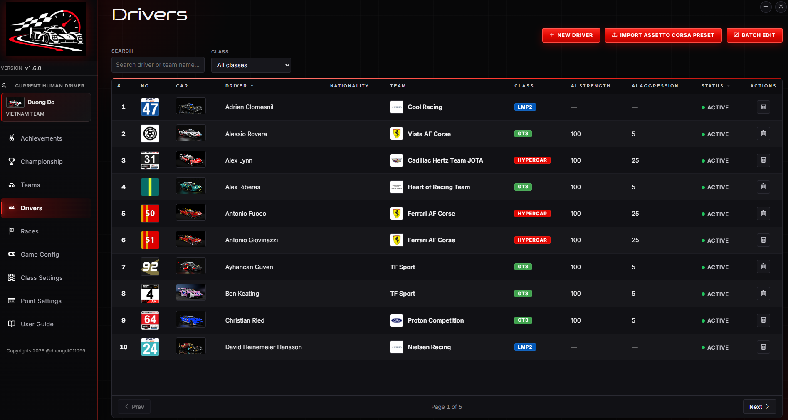
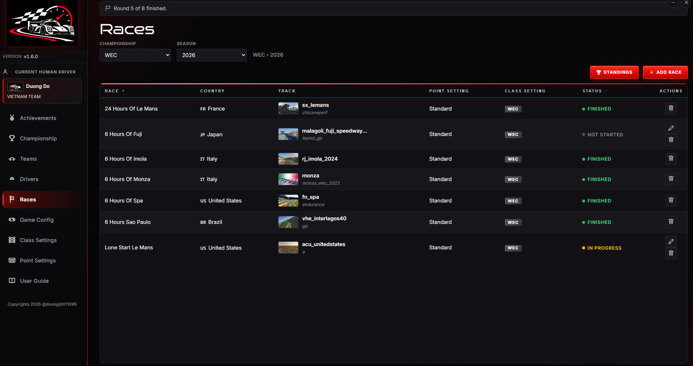
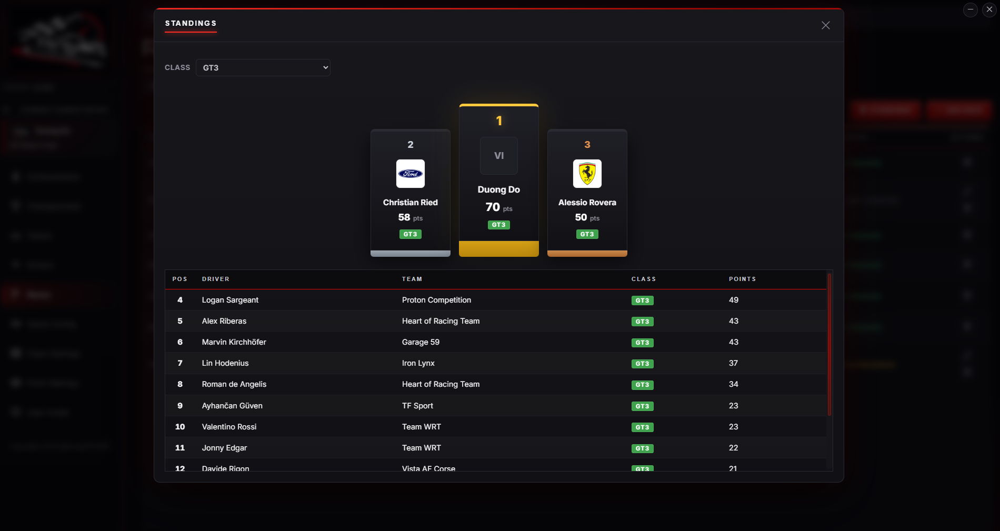
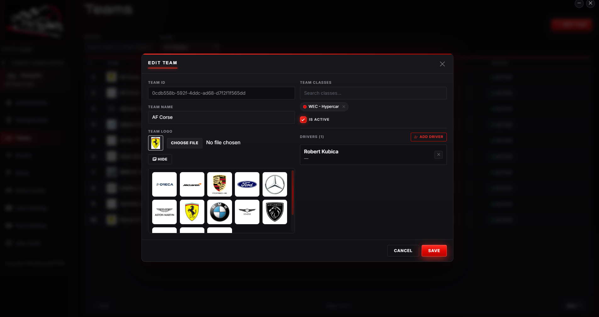
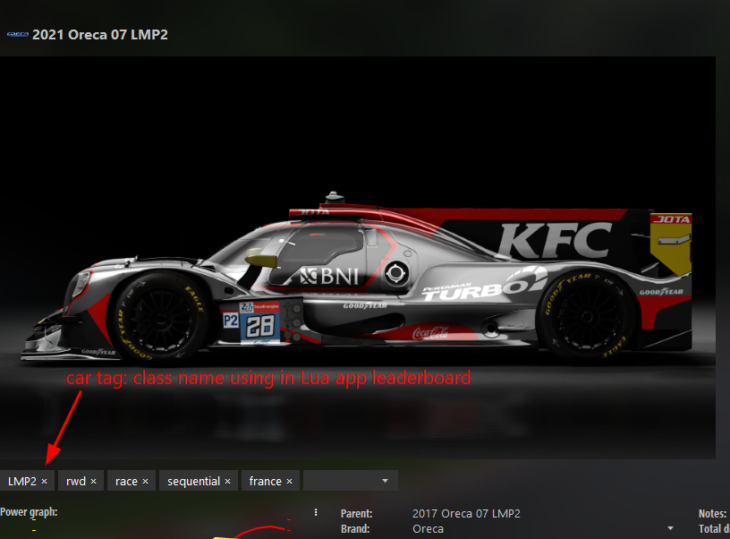
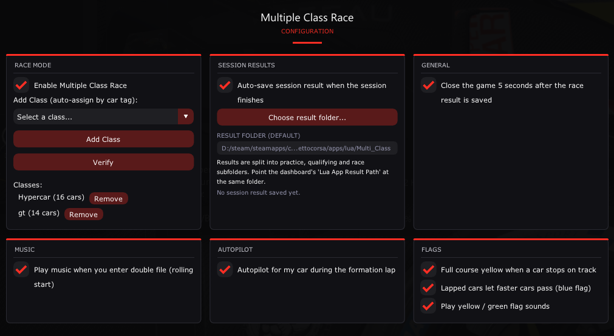

# Asetto Corsa Multi-Class Race Dashboard






The Multi-Class Race Dashboard helps you run and manage a multi-class racing championship — Hypercar, LMP2 and GT3 — in Assetto Corsa and Content Manager. It covers everything from your entry list to the final race results and championship points, all in one place.

## What you can do

- **Manage your series** — create championships, add seasons, create races, and watch each race move through its status: not started, in progress (after practice/qualifying results are loaded), and finished (after the race is done). You can clone a season to reuse its full race calendar for a new one.
- **Define your classes** — build class settings on the **Class Settings** page: a named set of classes (for example Hypercar, LMP2, GT3), each with its own color, reorderable, with one set marked as the default.
- **Manage teams and drivers** — assign each team its classes (one class per class setting), set each driver's car and skin, AI strength and aggression, nationality, and flag who is driving for real (human driver). Drivers take their classes from their team.
- **Set up and run race sessions** — choose which teams race in which event, then run Practice, Qualifying and Race sessions.
- **Race by laps or by the clock** — set a race to a lap count (1–120) or a timed race from 5 minutes up to 24 hours. Assetto Corsa only supports lap-limited races, so for a timed race the in-game Lua app runs the race clock and ends the race on the leader's final lap once time is up.
- **Import results automatically** — load practice/qualifying results and the final race result, and the dashboard handles standings and points for you.
- **Create ready-to-load grids** — generate grid and race preset files you can open directly in Content Manager, ordered by class and qualifying position.
- **See the cars** — preview each car's livery right from your game installation.
- **Score the championship your way** — set up your own point systems (who earns points for finishing where) and apply them per race.
- **Run full seasons with a fixed number of rounds** — each season has a set number of rounds (8 by default). When every round is finished the season ends and becomes read-only: its races can no longer be added, edited or deleted, and the season cannot be deleted. Seasons created before rounds existed show **Rounds not set**; set the rounds on the **Championship** page before adding races to them.
- **Become World Champion** — when the last round of a season finishes and you are first in your class, a celebration popup shows the diamond cup and the class podium. Otherwise a toast tells you where you finished.
- **Collect trophies** — the **Achievements** page is your trophy cabinet. You earn a gold cup for every race you win, silver and bronze cups for finishing second or third in a season, and a large diamond cup for a world title, each with the race or season engraved on it. Click a cup to see it on a podium with confetti.
- **Check for updates** — the sidebar shows the app version and lets you check for a newer release.

## Installing the app

1. Open the **GitHub Releases** page for this project.
2. Download the installer (`EnduranceRaceDashboardSetup.exe`).
3. Run the installer. If Windows shows a security prompt, choose **More info → Run anyway**.
4. Follow the on-screen steps and choose where to install it.
5. When finished, open **Endurance Race Dashboard** from the Start menu or desktop shortcut. It opens in its own window; closing the window keeps it running in the tray, and **Exit** in the tray menu stops it. It cannot be opened from a web browser. It needs the Microsoft Edge WebView2 Runtime, which current versions of Windows already include.
6. To update later, download the newest installer and run it again; your data is kept.

## Before you start

To use the dashboard you need:

- Assetto Corsa installed
- Content Manager installed
- The dashboard installed (see above)

## First-time setup

- **Game Path** — You have to choose the correct game path folder (Assetto Corsa Game Rooth Path) during the installation wizard.

## Running a race — step by step

1. **Create your championship.** From the **Championship** page, add a championship, then add a season to it. When you need another season with the same races, use the clone action on the season to copy it.
2. **Set up your classes.** On the **Class Settings** page, create a class setting — add each class with a name and color, reorder them, and mark one class setting as the default. Teams pick their classes from these settings.
3. **Create the races.** Open the season and add each race event (name, country, race length — laps or timed — and a point system — create one on the **Point Settings** page first if you haven't).
4. **Add teams and drivers.** Use the **Teams** and **Drivers** pages. Assign each team its classes, and you can create drivers one by one, or add a whole batch from a preset file.
5. **Set up the event.** Open the race and use the **Teams** tab to choose which teams are taking part.
6. **Practice and Qualifying.** After the session, import its result file. The race status moves to **in progress**. You can then export the qualifying grid and the race preset, ready to open in Content Manager.
7. **The race.** After the race finishes, import its result file from the race results folder. The dashboard builds the standings, applies the points, and marks the race as **finished**.
8. **Finish the season.** Each season has a fixed number of rounds, set when you add it and editable on the **Championship** page until it ends. You cannot add more races than that. When the last round is finished the season closes and goes read-only, trophies are awarded, and if you are first in your class you are crowned World Champion. Seasons from older versions show **Rounds not set**: enter the number of rounds there before adding races.
9. **Admire your trophies.** Open **Achievements** (below your human driver in the sidebar) to see your cups. Winning a race adds a gold cup; the season result adds a silver, bronze or diamond cup.

## Lua App - Multiclass Leaderboard (Driver posittion)

1. You have to configure the car tags in Content Manager to make the leaderboard work correctly.


2. In game class-leaderboard config - You have to choose the car tag to make the leaderboard auto order by class: eg: Hyperpar


## Rolling Start

**Rolling start is a MUST** You can not turn it off, during the formation lap, human driver can accelerate freely, no speed limit. You must respect the AI drivers in the single or double file formation.

## Tips

- A finished season is read-only. To reuse its calendar, clone it; the clone starts fresh with the same number of rounds.
- Round status updates as you go: no data means "not started", practice/qualifying loaded means "in progress", race loaded means "finished".
- A team can have one class per class setting. If you add a new class setting, go back to the **Teams** page and assign each team's class for it.
- One class setting is always the default and cannot be unset; to change it, open another class setting and mark it as the default instead.
- If two drivers use the same car and skin combo, load their results once with the right driver selected so they are not mixed up.
- If a result needs correcting, import the file again in place of the old one.
- Results come from the Multi_Class output; make sure the folder you enter in Game Config is the one those files are saved to.

## For contributors

The app is a Blazor Server (.NET) project with a SQLite database. Build and test it with:

```
dotnet build multi-class-race-dashboard.csproj
dotnet test tests/MulticlassRace.Tests
```

| Folder | What lives there |
| --- | --- |
| `Components/Pages` | One page per route. Each page is a thin `.razor` file (markup) plus a `.razor.cs` code-behind. |
| `Components/Features/<Feature>` | Dialogs and panels that belong to one feature (Teams, Drivers, Races, Achievements). |
| `Components/Shared` | Reusable pieces: `Modal`, `ConfirmDialog`, `FormField`, `AppSelect`, `DataTable`, `SortableHeader`, `Pagination`, `StatusBadge`, `PageBase`, ... Use these instead of writing new markup for dialogs, tables, or dropdowns. |
| `ViewModels` | What the UI binds to, plus plain classes holding UI rules (list queries, form validation, session rules) that can be unit tested without rendering anything. |
| `Common` | Small generic helpers such as `PagedList<T>` and `SortState<T>`. |
| `Mapping` | Entity to view-model mapping, as extension methods, one file per aggregate. |
| `Services/<Feature>` | Business logic grouped by feature (Championships, Races, Teams, Drivers, Settings, Results, AssettoCorsa, Updates, Notifications). An interface sits next to its implementation, and each feature registers itself in its own `*ServiceRegistration.cs`. |
| `BackgroundServices` | Hosted workers (update check, Lua result import and cleanup). |
| `Infrastructure` | Process-level plumbing: single-instance guard, tray icon, paths, logging, startup failure reporting. |
| `Web` | Middleware and HTTP endpoints (uploads, game images, game folder gate). |
| `Repositories` | EF Core data access. |
| `Data` | `AppDbContext`, one `IEntityTypeConfiguration` per entity in `Configurations`, JSON `Converters`, and `Seed` data. |
| `tests/MulticlassRace.Tests` | xUnit and bUnit tests. They use an in-memory SQLite database and never touch `app.db`. |

## License

This project is licensed under the **MIT License** with additional terms. See the [`LICENSE`](LICENSE) file for the full text.

- You may **read, study, and contribute** to the source code.
- The **author credit** ("Duong Do") must not be removed or changed in any copy or derivative work.
- Redistributing or publishing the **complete source code** as a standalone repository or release is **not permitted**.
- Results come from the [Multi Class Race Leaderboard](https://github.com/duongdt011099/ac-multi-class-race) output; make sure the folder you enter in Game Config is the one those files are saved to.
